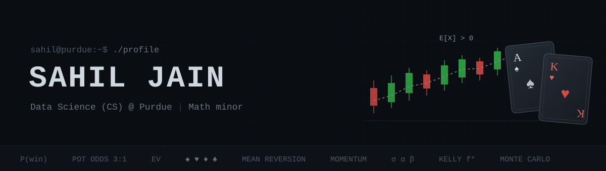

<p align="center">
  
</p>

```
sahil@purdue:~$ whoami
```

Data Science (Computer Science stream) student at **Purdue University**, minor in Mathematics.

I like problems where you have to make decisions under uncertainty, which is how I ended up building a poker bot and a trading-strategy backtester.

```
sahil@purdue:~$ cat stack.txt
```

<p>
  
  
  
  
  
  
  
  
  
  
  
</p>

```
sahil@purdue:~$ ./play --opponent=bot
```

<a href="https://poker-bot-ui.onrender.com"></a>

```
sahil@purdue:~$ contact
```

<a href="mailto:jain839@purdue.edu"></a>
<a href="https://www.linkedin.com/in/sahil-jain-sj7117"></a>
